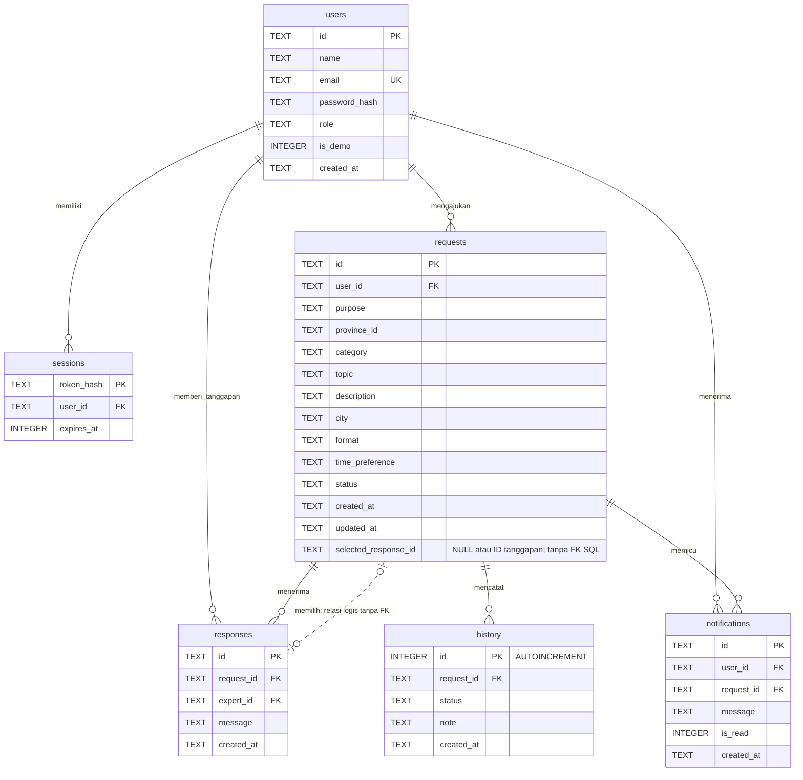

# Basis data SwaraNusa

Dokumen ini menjelaskan basis data yang dipakai aplikasi saat ini. Acuan utamanya adalah perintah `CREATE TABLE` dalam [`server.mjs`](../server.mjs), bukan rancangan fitur yang belum dibuat.

## Penyimpanan yang dipakai

| Data | Lokasi | Pengelolaannya |
| --- | --- | --- |
| Akun, sesi, request, tanggapan, riwayat, notifikasi | SQLite: `.data/swaranusa.sqlite` | Server membaca dan menyimpan data melalui API. |
| Daftar provinsi dan materi budaya | [`public/data.json`](../public/data.json) | Tim mengubah berkas JSON. Belum ada tabel SQL untuk konten budaya. |
| Foto dan aset tampilan | `public/assets/` | Halaman mengambil berkas gambar dari folder publik. |
| Draf form yang belum dikirim | `sessionStorage` pada browser | Browser mempertahankan isian selama sesi tab, termasuk saat pengguna harus masuk. |

SQLite membuat berkas basis data saat server pertama kali berjalan. Variabel `SWARANUSA_DB` dapat mengubah lokasinya. Berkas basis data dan sesi pengguna tidak perlu masuk repositori GitHub; server dapat membuat basis data kosong dari skema dalam kode.

## Diagram relasi tabel yang sudah berjalan

`PK` berarti kunci utama, `FK` berarti kunci asing, dan `UK` berarti nilai unik. Satu akun dapat memiliki banyak sesi, request, tanggapan, dan notifikasi. Setiap tanggapan, catatan riwayat, dan notifikasi berkaitan dengan satu request.

Garis berlabel **relasi logis tanpa FK** menggambarkan `requests.selected_response_id` yang menunjuk tanggapan pilihan. SQLite belum memiliki batasan `FOREIGN KEY` atau `UNIQUE` untuk kolom ini. Server memeriksa bahwa tanggapan berasal dari request yang sama dan pemberinya memiliki peran ahli. Kardinalitas pilihan pada diagram mengikuti aturan aplikasi tersebut. Semua garis relasi lainnya mengikuti FK yang sudah tercantum dalam SQL.

## Tanggung jawab tiap tabel

| Tabel | Isi dan aturan utama |
| --- | --- |
| `users` | Menyimpan nama, email unik, hash kata sandi, peran, penanda contoh, dan waktu pembuatan akun. `role` memiliki batasan SQL untuk `user`, `expert`, atau `admin`. Pendaftaran umum membuat peran `user`. |
| `sessions` | Menyimpan hash token sesi serta waktu kedaluwarsa dalam milidetik Unix. Cookie browser membawa token acak; basis data menyimpan hasil SHA-256 token tersebut. Sesi berlaku 24 jam. |
| `requests` | Menyimpan kebutuhan pengguna, provinsi, kategori, tujuan, status, serta ID tanggapan pilihan jika ada. `city`, `format`, dan `time_preference` memiliki nilai awal teks kosong. `selected_response_id` boleh `NULL`. |
| `responses` | Menyimpan isi tanggapan. Nama `expert_id` tetap dipakai juga ketika pengelola menanggapi request informasi; server memeriksa perannya sesuai tujuan request. |
| `history` | Menyimpan urutan perubahan status, catatan, dan waktu. Tabel ini belum menyimpan ID pelaku perubahan dalam kolom tersendiri. |
| `notifications` | Menyimpan pesan dalam akun dan kaitannya dengan request. `is_read` memakai `0` untuk belum dibaca dan `1` untuk sudah dibaca. |

Kolom data selain kunci utama dan `selected_response_id` memiliki `NOT NULL` sesuai skema. SQLite memperlakukan `TEXT PRIMARY KEY` sebagai kunci unik pada tabel ini; deklarasinya tidak menambahkan `NOT NULL` terpisah. Server selalu membuat ID sebelum menyimpan baris baru. Semua waktu berakhiran `_at` memakai teks ISO 8601 UTC, kecuali `sessions.expires_at` yang memakai bilangan milidetik Unix.

## Relasi dan penghapusan

Server mengaktifkan `PRAGMA foreign_keys = ON`. Perilaku penghapusan mengikuti skema berikut; aplikasi belum menyediakan tombol untuk menghapus akun atau request.

| FK | Perilaku SQL |
| --- | --- |
| `sessions.user_id → users.id` | `ON DELETE CASCADE` |
| `requests.user_id → users.id` | Tanpa `CASCADE`; referensi request dapat mencegah penghapusan akun. |
| `responses.request_id → requests.id` | `ON DELETE CASCADE` |
| `responses.expert_id → users.id` | Tanpa `CASCADE`; referensi tanggapan dapat mencegah penghapusan akun. |
| `history.request_id → requests.id` | `ON DELETE CASCADE` |
| `notifications.user_id → users.id` | `ON DELETE CASCADE` |
| `notifications.request_id → requests.id` | `ON DELETE CASCADE` |

Indeks tambahan berada pada `requests.user_id`, `responses.request_id`, `notifications.user_id`, dan `sessions.expires_at`. Server memakai transaksi saat mengirim request, menambah tanggapan, dan mengubah status agar riwayat serta notifikasi mengikuti perubahan yang sama.

## Aturan yang diperiksa server

Server memeriksa `purpose`, `province_id`, `category`, `format`, status, kepemilikan request, dan hak akses peran sebelum mengubah data. Kolom-kolom tersebut belum memiliki semua batasan `CHECK` atau FK dalam SQLite. Contohnya, `requests.province_id` mengacu pada kode provinsi dalam aplikasi dan JSON, bukan pada tabel `provinces` di SQLite.

Pengguna harus memberikan `consent: true` saat mengirim kebutuhan. Versi ini memeriksa persetujuan pada API, tetapi belum menyimpan persetujuan atau waktu persetujuan dalam kolom tersendiri. `is_demo` dan `is_read` berbentuk bilangan di SQLite; API mengubahnya menjadi boolean JSON.

`userName`, `expertName`, `isDemo` pada tanggapan, serta larik `responses` dan `history` pada hasil API merupakan hasil penggabungan atau pembacaan tabel. Nilai tersebut bukan kolom tambahan dalam `requests` atau `responses`.

## Akun contoh dan keamanan data

Server lokal menyediakan akun pengunjung, pendamping, dan pengelola contoh. Kolom `users.is_demo` menandainya. Endpoint demo hanya menerima akses lokal ketika fitur demo aktif. Akun pendamping contoh belum mewakili praktisi nyata; server belum menyimpan nomor telepon, jadwal, harga, atau profil layanan ahli dalam tabel terpisah.

Server membuat hash kata sandi dengan scrypt dan salt acak. Cookie sesi memakai `HttpOnly` dan `SameSite=Strict`. Data basis data tetap berada di luar folder `public`; server hanya melayani berkas di dalam folder tersebut. Pengaturan ini melayani pratinjau lokal. Tim perlu menyiapkan HTTPS, pengelolaan akun ahli, dan konfigurasi penerapan sebelum membuka layanan publik.

## Rencana bila konten berpindah ke SQL

Bagian ini merupakan usulan pengembangan, belum menjadi skema aplikasi. Tim dapat menambah tabel `provinces`, `categories`, `entries`, `entry_steps`, dan `entry_facts`, lalu memindahkan `public/data.json` melalui migrasi. Tabel profil pendamping dan cakupan layanan dapat menyusul ketika ada mitra nyata. Jangan memasukkan tabel rencana tersebut ke ERD implementasi saat menjelaskan versi yang berjalan sekarang.

Salinan perintah pembuatan tabel dan indeks tanpa data pribadi tersedia di [`schema.sql`](schema.sql). Alur penggunaan dan perubahan status tersedia di [`flowchart.md`](flowchart.md).
