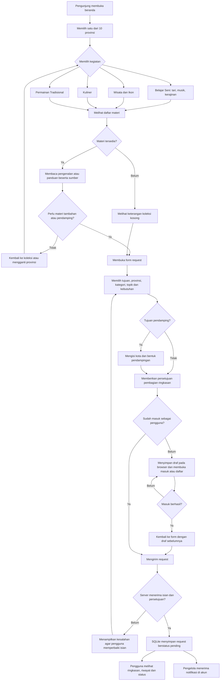
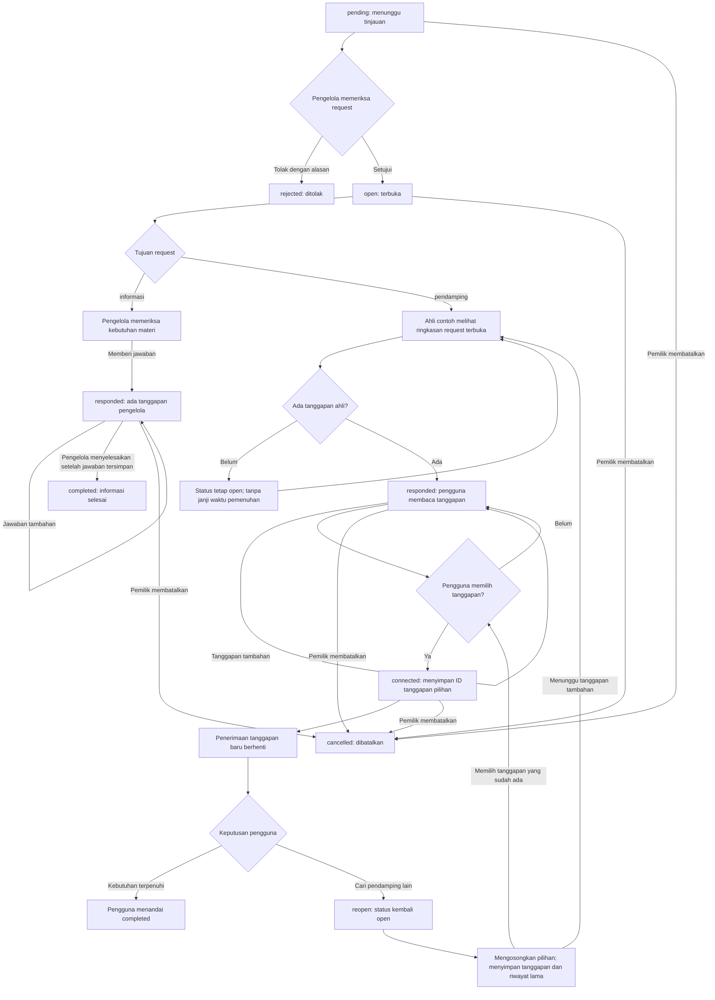

# Alur penggunaan SwaraNusa

Diagram ini mengikuti konsep provinsi sebagai pintu masuk dan aturan API dalam [`server.mjs`](../server.mjs). Pengunjung dapat membaca materi tanpa akun. Akun diperlukan untuk mengirim dan melacak request. Pendamping serta pengelola memakai ruang akun sesuai perannya.

## Menjelajah dan mengirim kebutuhan

Pengguna dapat membuka form dari halaman umum maupun dari konteks provinsi atau materi. Browser mempertahankan draf pada `sessionStorage` saat pengguna perlu masuk. Server tetap memeriksa sesi, peran, persetujuan, dan isian sebelum menyimpan request.

## Tinjauan, tanggapan dan penyelesaian

Ahli contoh memiliki cakupan simulasi untuk seluruh kategori dan sepuluh provinsi. Pengelola hanya memberi tanggapan pada request informasi, sedangkan ahli hanya memberi tanggapan pada request pendamping yang terbuka atau sudah menerima tanggapan. Setelah request terhubung, selesai, ditolak, atau dibatalkan, server menolak tanggapan baru.

Pada versi ini belum ada nomor kontak atau pemesanan pendamping nyata. Pemilihan tanggapan contoh memperagakan perubahan status. Dalam konsep layanan dengan mitra nyata, pengguna dan pendamping melanjutkan pembicaraan melalui kontak yang telah disetujui pemiliknya; biaya serta jadwal memerlukan kesepakatan kedua pihak.

## Ringkasan perubahan status

| Status awal | Tindakan | Pelaku | Syarat | Status sesudahnya |
| --- | --- | --- | --- | --- |
| Belum ada | Mengirim request | Pengguna | Sesi valid, isian sesuai, persetujuan benar | `pending` |
| `pending` | `approve` | Pengelola | Request belum ditinjau | `open` |
| `pending` | `reject` | Pengelola | Menyertakan alasan | `rejected` |
| `open`, `responded` | Menambah tanggapan | Ahli | Tujuan `pendamping` | `responded` |
| `open`, `responded` | Menambah tanggapan | Pengelola | Tujuan `informasi` | `responded` |
| `open`, `responded` | `select` | Pemilik | Tujuan `pendamping`; memilih tanggapan yang sudah ada dari ahli dan request yang sama | `connected` |
| `connected` | `reopen` | Pemilik | Tujuan `pendamping` | `open` |
| `connected` | `complete` | Pemilik | Tujuan `pendamping`; kebutuhan telah terpenuhi menurut pemilik | `completed` |
| `responded` | `complete` | Pengelola | Tujuan `informasi`; setidaknya satu jawaban pengelola telah tersimpan | `completed` |
| `pending`, `open`, `responded`, `connected` | `cancel` | Pemilik | Request milik akun tersebut | `cancelled` |

Reopen menghapus `selected_response_id`, tetapi mempertahankan tanggapan dan riwayat. Pada status `open`, pengguna dapat memilih tanggapan yang sudah ada tanpa menunggu tanggapan baru. Pengguna juga dapat menunggu tanggapan tambahan. Versi ini belum menyediakan penyuntingan request yang ditolak atau pembukaan kembali request selesai; pengguna dapat membuat request baru.

Pengelola harus menyimpan jawaban sebelum menyelesaikan request informasi. Server menolak tindakan `complete` pada request informasi yang masih `open` tanpa jawaban, sehingga pemilik tidak menerima status selesai tanpa penjelasan yang dapat dibaca.

## Hak akses dan notifikasi

| Peran | Akses request |
| --- | --- |
| Pengunjung tanpa akun | Membaca provinsi dan materi; belum dapat membaca daftar request atau mengirim kebutuhan. |
| Pengguna | Membaca request sendiri, melihat tanggapan, serta menjalankan tindakan pemilik sesuai status. |
| Ahli | Membaca request pendamping aktif yang telah disetujui. Setelah memberi tanggapan, ahli masih dapat melihat request tersebut saat statusnya berubah. Hasil API hanya menampilkan tanggapan milik ahli itu sendiri. |
| Pengelola | Membaca semua request, meninjau request baru, serta menjawab dan menyelesaikan request informasi. |

Server membuat notifikasi dalam akun saat ada request baru, persetujuan request pendamping, tanggapan, pilihan pendamping, atau perubahan status terkait. Pengguna membuka atau memuat ulang halaman akun untuk membacanya. Versi ini belum mengirim email, WhatsApp otomatis, atau notifikasi langsung. Payload request tidak memuat email pemohon. Alur ini memakai skema yang dijelaskan dalam [`database.md`](database.md).
